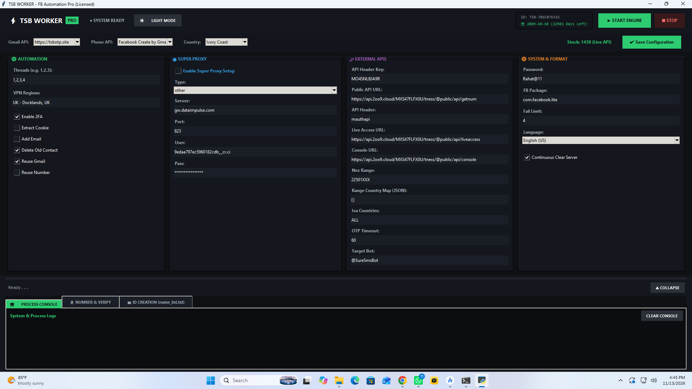

# ⚡ TSB WORKER - FB Automation Pro

**TSB Worker - FB Automation Pro** is a high-performance Windows desktop automation suite built with Python and Tkinter, engineered for multi-instance LDPlayer automation, SMS/OTP verification, Super Proxy management, and fully automated Meta Account / Facebook Lite registration.

---

## 🖥️ UI Preview



*(Place your UI screenshot as `assets/ui_preview.png`)*

---

## 🚀 Key Features & Capabilities

- **Multi-Instance LDPlayer Control**: Run up to 4+ LDPlayer emulators simultaneously in staggered asynchronous boot sequences with thread-safe ADB/LDConsole subprocess locking.
- **Automated 8-Step Meta / FB Lite Registration Flow**:
  1. Click "Create new account"
  2. Click "Get started"
  3. Enter First & Last Name randomly from `name_list.txt`
  4. Select Date of Birth (Age 18-24 young adult fast wheel scrolling)
  5. Select Gender randomly (`male` / `female` with exact text matching)
  6. Enter Mobile Number (auto-allocated from SMS API)
  7. Enter Secure Password
  8. Click final "I agree" terms & policies agreement
- **Session Cookie & Credential Extraction**: Automatically extracts full real session cookies (`c_user`, `xs`, `datr`, `fr`, `sb`) and UID after registration completion and saves them securely to `account.txt` in the project root.
- **Super Proxy & External APIs Integration**: Seamless proxy configuration (`com.scheler.superproxy`) with auto-installation support for missing APKs from the `apps/` directory.
- **Central Theme Engine & Dark/Light Mode**: Instant theme toggle between Dark and Light mode directly from the top navigation bar.
- **Tabbed Resizable Console**: 3-tab bottom console featuring Process Console, Number & Verify, and ID Creation table with a mouse-resizable drag bar and collapse/expand toggle.

---

## 🛠️ Tech Stack

- **Language**: Python 3.10+
- **GUI Framework**: Tkinter & ttk
- **Automation Engine**: LDPlayer Console (`ldconsole.exe`) & ADB (`adb.exe`)
- **Concurrency**: Python `threading` with thread-safe subprocess serialization and asynchronous boot/workflow workers.

---

## 📦 Project Structure

```text
fb_worker_pro/
│
├── main.py                  # Entry point
├── config.json              # App configuration & API keys
├── name_list.txt            # Random account naming data
├── account.txt              # Generated UIDs, passwords & session cookies output
│
├── ui/                      # Tkinter User Interface
│   ├── main_window.py       # Main dashboard, config panels & tabbed console
│   └── theme.py             # Central theme engine (Dark & Light palettes)
│
├── services/                # Automation & Integration Services
│   ├── automation_service.py# Two-phase staggered boot & parallel workflow coordinator
│   ├── ldplayer_service.py  # LDPlayer, ADB, UI hierarchy, auto-install & 8-step registration
│   ├── proxy_service.py     # Super proxy credential validator & region updater
│   └── api_service.py       # OTP number allocation & public API resolver
│   └── system_service.py    # System utilities
│
└── apps/                    # Bundled APK binaries
    ├── fblite.apk           # Facebook Lite APK
    └── super-proxy.apk      # Super Proxy APK
```

---

## ⚙️ Installation & Usage

1. **Clone the repository**:
   ```bash
   git clone https://github.com/your-username/fb_worker_pro.git
   cd fb_worker_pro
   ```
2. **Run the application**:
   ```bash
   python main.py
   ```

---

## 📜 License
Licensed under TSB Worker Pro Commercial License. All rights reserved.
